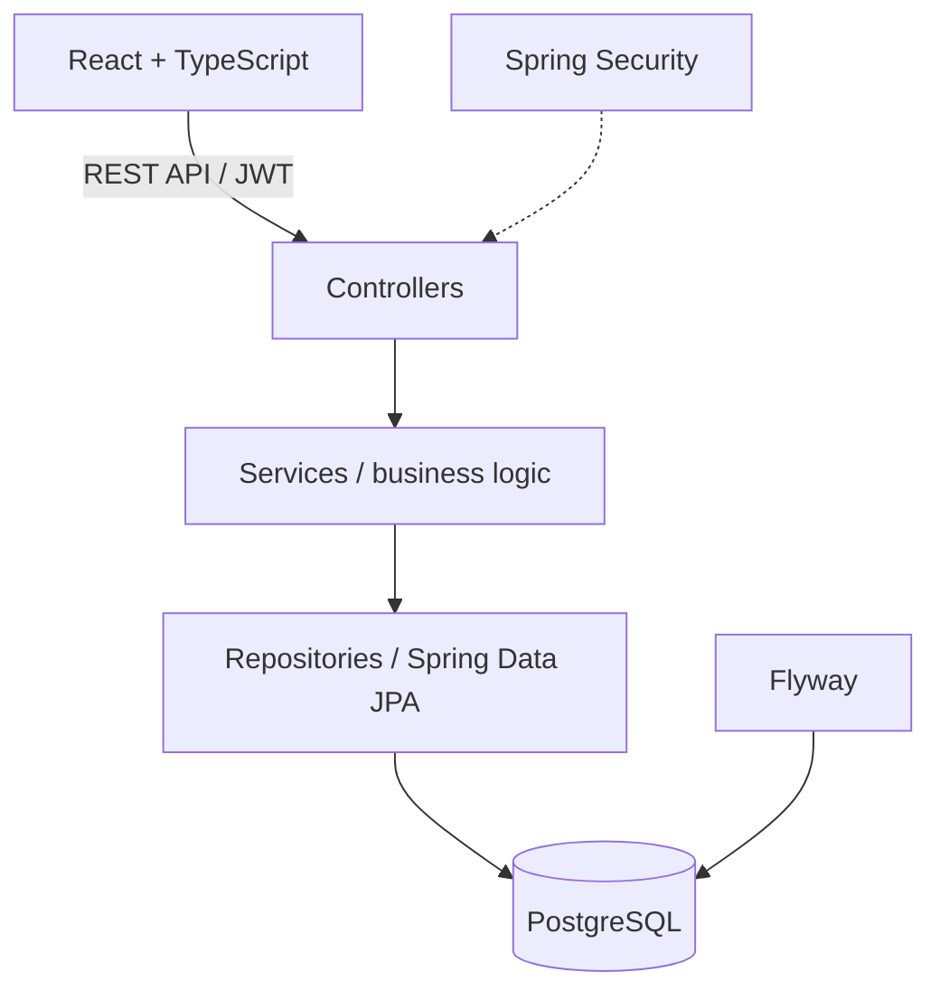

# Acopio — Inventory and Sales Management

Commercial management platform that centralizes inventory, sales, supplier purchases and daily cash closing.

The system incorporates business rules focused on inventory consistency, movement traceability and role-based access control. Its primary use case is automotive repair shops, with management of spare parts, lubricants, customers and vehicles.

[Versión en español](README.md)

## Features

- **Products and inventory:** low-stock alerts, movement history and soft deletion.
- **Sales:** labor, payment method, customer and vehicle; deducts stock when recorded and restores it when cancelled.
- **Purchases:** supplier management and replenishment suggestions; increases stock upon receipt.
- **Cash management:** daily closing by payment method.
- **Dashboard and reports:** refresh every 30 seconds.
- **Security:** JWT authentication and `ADMIN` and `OPERADOR` roles.
- **Interface:** light and dark themes.

## Architecture

Layered architecture based on the documented repository structure. The frontend consumes the REST API, while the backend handles business rules and data access.

[Architecture documentation](docs/en/architecture.md)

## Business rules

| Operation | Effect |
|---|---|
| Record a sale | Deducts stock. |
| Cancel a sale | Restores stock. |
| Receive a purchase | Increases stock. |
| Adjust inventory | Applies a positive or negative delta. |
| Change stock | Records the movement. |
| Deactivate a product | Uses soft deletion. |

The `OPERADOR` role can perform routine operations but cannot deactivate products, manage users or suppliers, or cancel purchases.

[Business rules and permissions](docs/en/business-rules.md)

## Tech stack

| Layer | Technology |
|---|---|
| Backend | Java 21, Spring Boot 3.2, Spring Security, JWT, Spring Data JPA |
| Frontend | React 18, TypeScript, Vite, TanStack Query, Axios |
| Database | PostgreSQL, Flyway |
| API documentation | Swagger/OpenAPI |

## Local setup

Requirements: Java 21, Maven, Node.js 20+ and PostgreSQL or Docker.

1. Start PostgreSQL and configure the backend local profile.
2. Run the backend with Maven.
3. Install frontend dependencies and run `npm run dev`.

- Frontend: http://localhost:5173
- API: http://localhost:8080
- Swagger: http://localhost:8080/swagger-ui.html

[Complete setup, configuration and initial login guide](docs/en/setup.md)

## Repository structure

- `backend/`: controllers, services, repositories, model, security and Flyway migrations.
- `frontend/`: React application, pages, components, hooks and styles.
- `branding/`: Acopio visual identity.
- `docs/`: technical documentation and reference SQL scripts.

## Documentation

- [Architecture](docs/en/architecture.md)
- [Business rules](docs/en/business-rules.md)
- [Setup and configuration](docs/en/setup.md)

[Portfolio](https://francoamarilla.github.io/portfolio/) · [LinkedIn](https://www.linkedin.com/in/franco-maximiliano-amarilla/)
