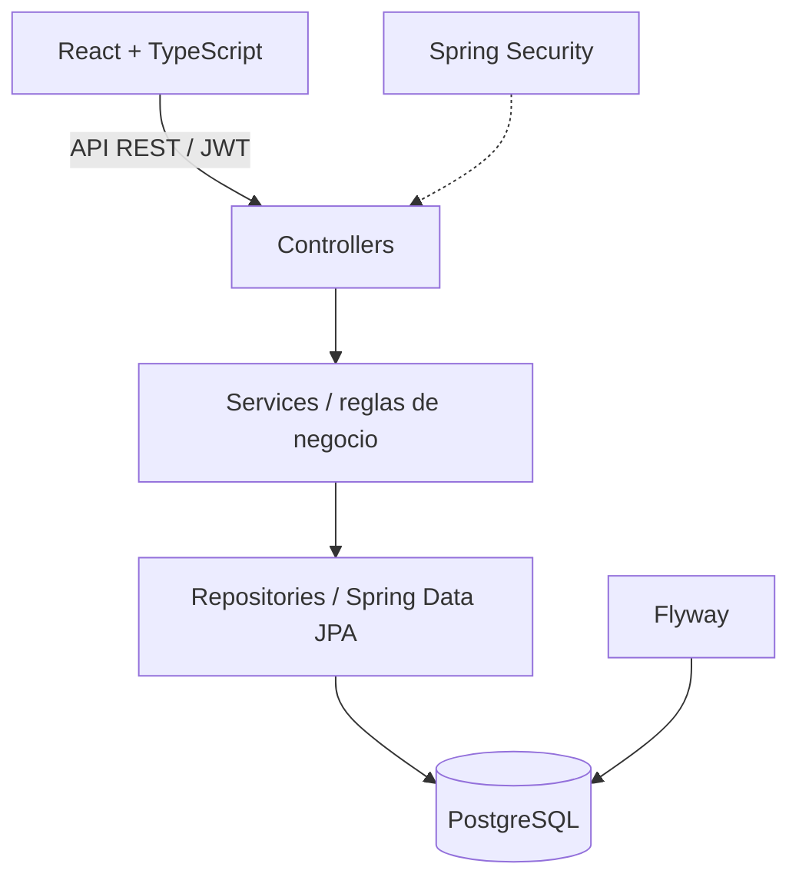

# Acopio — Sistema de gestión de stock y ventas

Plataforma de gestión comercial que centraliza el inventario, las ventas, las compras a proveedores y los cierres de caja.

El sistema incorpora reglas de negocio orientadas a la consistencia del inventario, la trazabilidad de movimientos y el control de acceso basado en roles. Su caso de uso principal son los talleres mecánicos, con gestión de repuestos, lubricantes, clientes y vehículos.

[English version](README.en.md)

## Funcionalidades

- **Productos y stock:** alertas de stock mínimo, historial de movimientos y baja lógica.
- **Ventas:** mano de obra, medio de pago, cliente y vehículo; descuentan existencias al registrarse y las restituyen al anularse.
- **Compras:** gestión de proveedores y sugerencias de reposición; incrementan el stock al recibirse.
- **Caja:** cierres diarios por medio de pago.
- **Dashboard y reportes:** actualización cada 30 segundos.
- **Seguridad:** autenticación JWT y roles `ADMIN` y `OPERADOR`.
- **Interfaz:** temas claro y oscuro.

## Arquitectura

Arquitectura por capas basada en la estructura documentada del proyecto. El frontend consume la API REST y el backend concentra las reglas de negocio y el acceso a datos.

[Documentación de arquitectura](docs/architecture.md)

## Reglas de negocio

| Operación | Efecto |
|---|---|
| Registrar venta | Descuenta stock. |
| Anular venta | Restituye stock. |
| Recibir compra | Incrementa stock. |
| Ajustar inventario | Aplica un delta positivo o negativo. |
| Modificar existencias | Registra el movimiento. |
| Dar de baja un producto | Baja lógica. |

El rol `OPERADOR` puede realizar operaciones cotidianas, pero no puede dar de baja productos, administrar usuarios o proveedores, ni anular compras.

[Reglas de negocio y permisos](docs/business-rules.md)

## Stack tecnológico

| Capa | Tecnología |
|---|---|
| Backend | Java 21, Spring Boot 3.2, Spring Security, JWT, Spring Data JPA |
| Frontend | React 18, TypeScript, Vite, TanStack Query, Axios |
| Base de datos | PostgreSQL, Flyway |
| Documentación de API | Swagger/OpenAPI |

## Ejecución local

Requisitos: Java 21, Maven, Node.js 20+ y PostgreSQL o Docker.

1. Iniciar PostgreSQL y configurar el perfil local del backend.
2. Ejecutar el backend con Maven.
3. Instalar las dependencias del frontend y ejecutar `npm run dev`.

- Frontend: http://localhost:5173
- API: http://localhost:8080
- Swagger: http://localhost:8080/swagger-ui.html

[Guía completa de instalación, configuración y primer acceso](docs/setup.md)

## Estructura del repositorio

- `backend/`: controllers, services, repositories, model, security y migraciones Flyway.
- `frontend/`: aplicación React, páginas, componentes, hooks y estilos.
- `branding/`: identidad visual de Acopio.
- `docs/`: documentación técnica y scripts SQL de referencia.

## Documentación

- [Arquitectura](docs/architecture.md)
- [Reglas de negocio](docs/business-rules.md)
- [Instalación y configuración](docs/setup.md)

[Portfolio](https://francoamarilla.github.io/portfolio/) · [LinkedIn](https://www.linkedin.com/in/franco-maximiliano-amarilla/)
