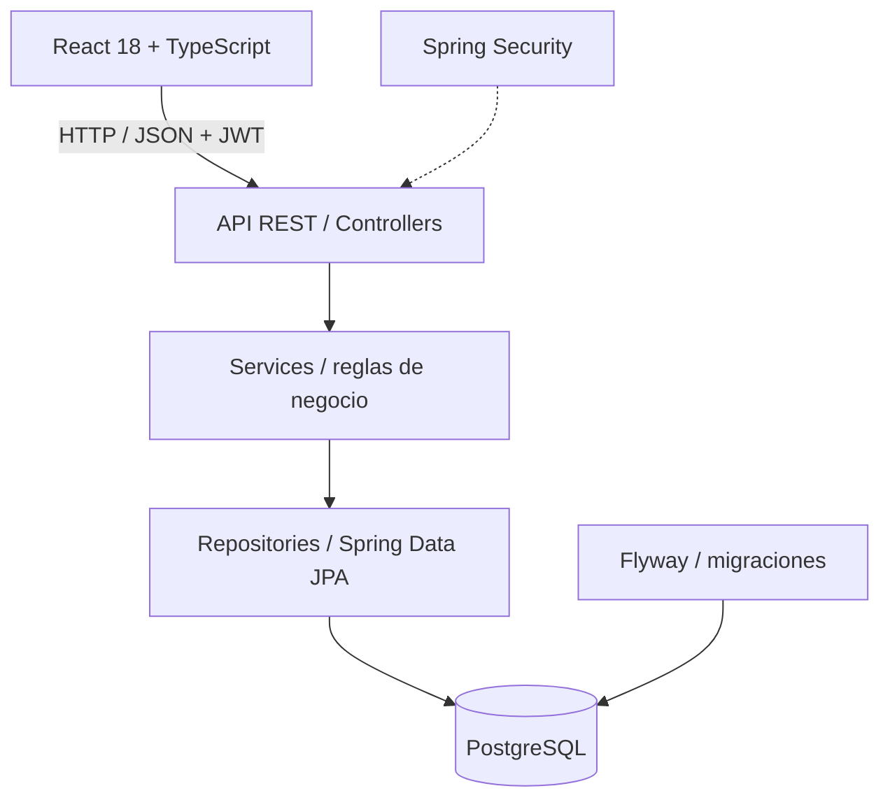

# Arquitectura

[English version](en/architecture.md) · [README](../README.es.md)

Acopio utiliza una arquitectura cliente-servidor con una aplicación web React y una API REST Spring Boot.

## Responsabilidades

| Componente | Responsabilidad |
|---|---|
| Frontend | Pantallas, componentes, navegación y consultas al backend mediante Axios y TanStack Query. |
| Controllers | Interfaz HTTP de la aplicación. |
| Services | Lógica de inventario y operaciones comerciales. |
| Repositories | Acceso a datos mediante Spring Data JPA. |
| Model | Representación de las entidades del dominio. |
| Security | Autenticación JWT y autorización. |
| PostgreSQL | Persistencia de los datos. |

## Evolución del esquema

Flyway administra las migraciones en `backend/src/main/resources/db/migration/`. Hibernate utiliza el modo `validate`, de modo que no se utiliza la generación automática de tablas para evolucionar el esquema. Cada cambio requiere una nueva migración; no se deben editar las ya aplicadas.

## API

Swagger/OpenAPI documenta los endpoints en `http://localhost:8080/swagger-ui.html`. Las operaciones de la API de negocio requieren un token Bearer; el inicio de sesión es la excepción documentada.

El diagrama representa la estructura lógica documentada del repositorio, no una verificación exhaustiva de cada implementación interna.

Ver [reglas de negocio](business-rules.md) e [instalación](setup.md).
