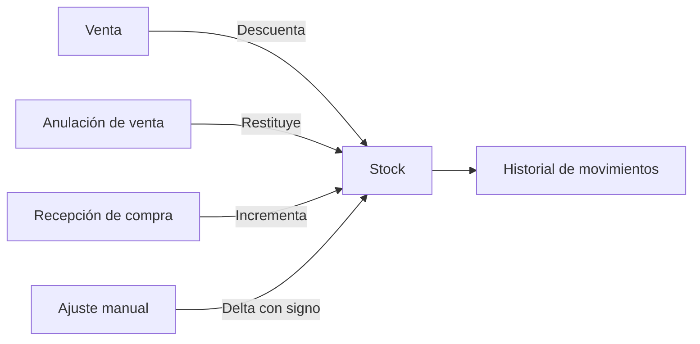

# Reglas de negocio

[English version](en/business-rules.md) · [README](../README.md)

## Inventario

| Operación | Efecto documentado |
|---|---|
| Registrar una venta | Descuenta las unidades vendidas. |
| Anular una venta | Restituye las unidades al inventario. |
| Recibir una compra | Incrementa las existencias. |
| Ajuste manual | Aplica un delta con signo: positivo suma, negativo resta. |
| Baja de producto | Utiliza baja lógica. |

Los cambios de stock quedan registrados como movimientos. El historial permite consultar las modificaciones de existencias. El sistema también incluye alertas de stock mínimo y sugerencias de reposición.

## Operaciones comerciales

Las ventas contemplan mano de obra, medio de pago, cliente y vehículo. Las compras se registran por proveedor. La caja permite cierres diarios por medio de pago; el dashboard y los reportes se actualizan cada 30 segundos según la documentación actual.

## Control de acceso

El sistema define los roles `ADMIN` y `OPERADOR`. El operador puede realizar las operaciones habituales, pero tiene restricciones específicas:

| Acción | ADMIN | OPERADOR |
|---|---|---|
| Operación cotidiana | Rol administrativo | Permitida según reglas de negocio |
| Dar de baja productos | Acción administrativa | No permitida |
| Administrar usuarios o proveedores | Acción administrativa | No permitida |
| Anular compras | Acción administrativa | No permitida |

La tabla resume las restricciones documentadas, no una auditoría exhaustiva de todos los endpoints. No se afirma una estrategia específica de bloqueo concurrente, atomicidad transaccional ni cobertura de pruebas sin comprobar el código correspondiente.

Ver [arquitectura](architecture.md).
