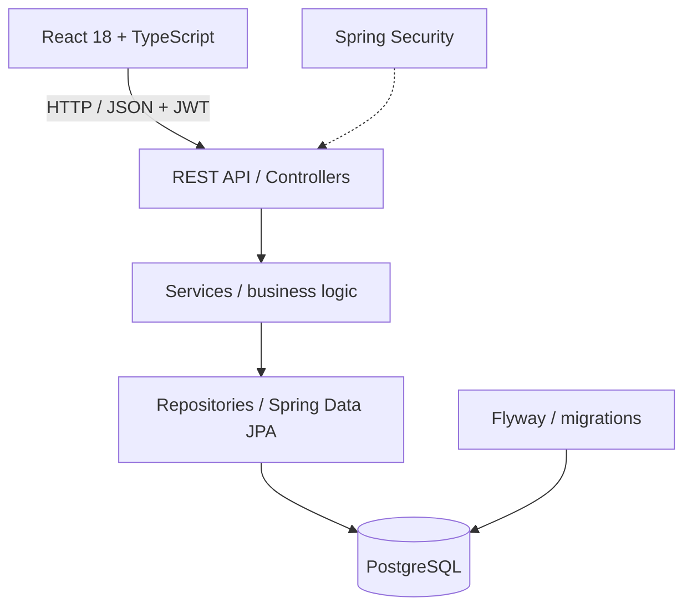

# Architecture

[Versión en español](../architecture.md) · [README](../../README.md)

Acopio uses a client-server architecture with a React web application and a Spring Boot REST API.

## Responsibilities

| Component | Responsibility |
|---|---|
| Frontend | Screens, components, navigation and backend requests using Axios and TanStack Query. |
| Controllers | HTTP interface. |
| Services | Inventory and commercial business logic. |
| Repositories | Data access through Spring Data JPA. |
| Model | Domain entities. |
| Security | JWT authentication and authorization. |
| PostgreSQL | Data persistence. |

## Schema evolution

Flyway manages migrations in `backend/src/main/resources/db/migration/`. Hibernate runs in `validate` mode rather than automatically evolving tables. Schema changes require a new migration; never edit a migration that has already been applied.

## API

Swagger/OpenAPI documents endpoints at `http://localhost:8080/swagger-ui.html`. Business API requests require a Bearer token, with login as the documented exception.

The diagram represents the documented logical repository structure, not an exhaustive verification of every internal implementation.

See [business rules](business-rules.md) and [setup](setup.md).
