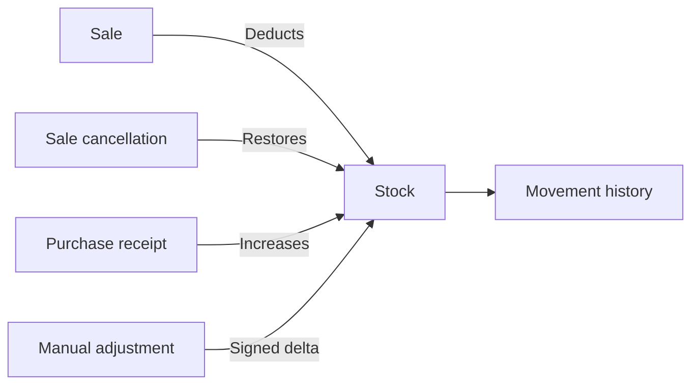

# Business rules

[Versión en español](../business-rules.md) · [README](../../README.md)

## Inventory

| Operation | Documented effect |
|---|---|
| Record a sale | Deducts sold units. |
| Cancel a sale | Restores units to inventory. |
| Receive a purchase | Increases stock. |
| Manual adjustment | Applies a signed delta: positive adds, negative subtracts. |
| Deactivate a product | Uses soft deletion. |

Stock changes are recorded as movements. The history makes inventory changes traceable. The system also includes low-stock alerts and replenishment suggestions.

## Commercial operations

Sales include labor, payment method, customer and vehicle. Purchases are recorded by supplier. Cash management supports daily closing by payment method; dashboards and reports refresh every 30 seconds, according to the current documentation.

## Access control

The system defines `ADMIN` and `OPERADOR` roles. Operators can carry out routine operations, subject to specific restrictions:

| Action | ADMIN | OPERADOR |
|---|---|---|
| Routine operations | Administrative role | Allowed within business rules |
| Deactivate products | Administrative action | Not allowed |
| Manage users or suppliers | Administrative action | Not allowed |
| Cancel purchases | Administrative action | Not allowed |

This table summarizes documented restrictions, not a complete endpoint authorization audit. No specific concurrency locking, transactional atomicity or test coverage is claimed without verifying the corresponding implementation.

See [architecture](architecture.md).
